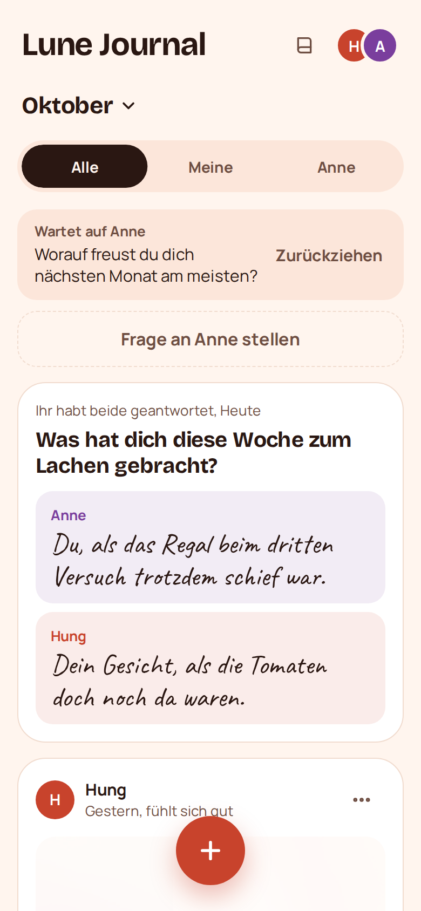
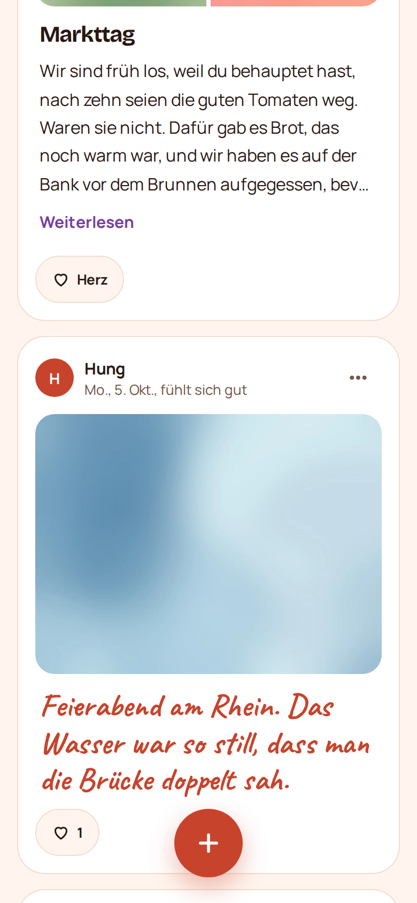
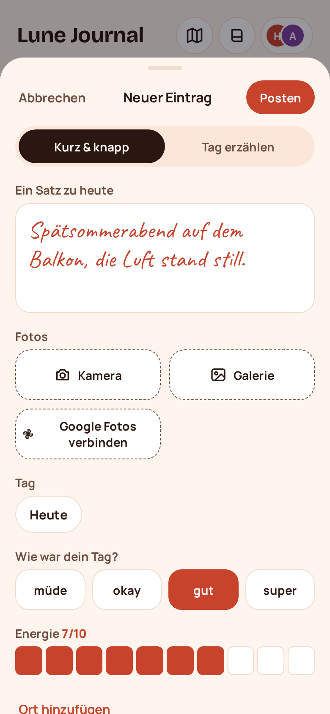
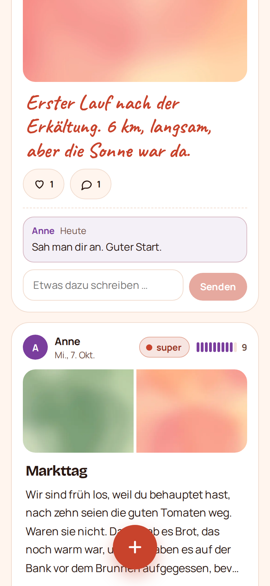
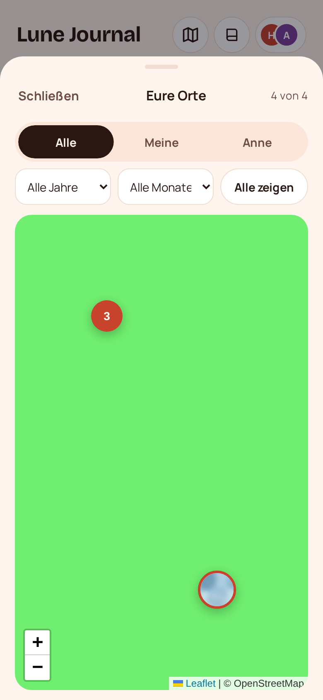
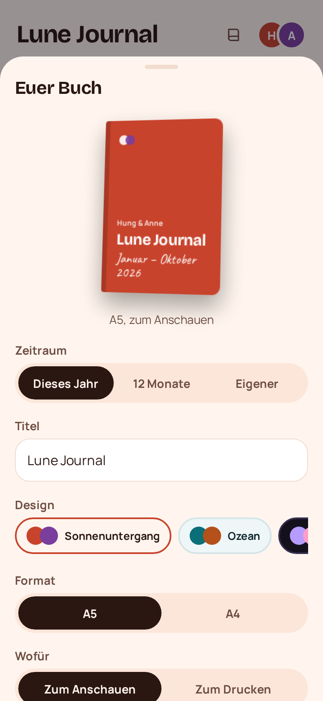
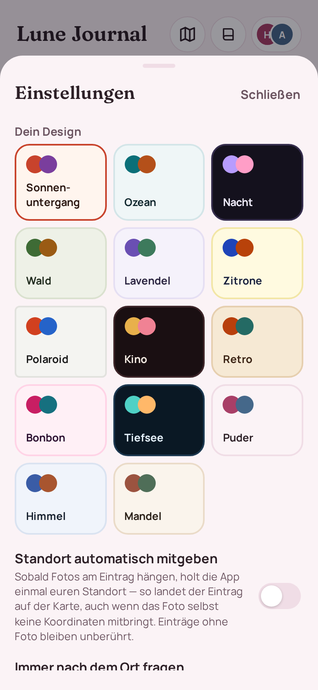
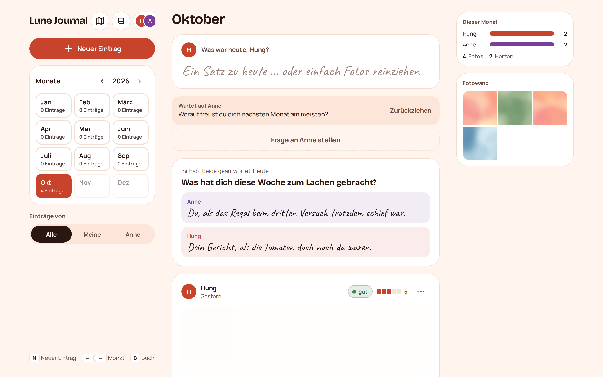

# Lune Journal

Ein Tagebuch für zwei Personen. Ich habe es gebaut, weil wir unsere Einträge und Fotos nicht auf
die Plattform von irgendwemandem laden wollten: kein Feed, keine Likes von Fremden, keine Werbung.
Die App läuft auf einem eigenen Server unter
[lune-journal.duckdns.org](https://lune-journal.duckdns.org) und lässt genau zwei Google-Konten
rein — die Adressen stehen in der `.env`, alle anderen bekommen eine freundliche Absage.

Auf dem Handy installiert ihr sie wie eine normale App (PWA), auf dem Laptop gibt es einen
Schreibtisch mit Seitenleiste. Am Jahresende macht die App aus allen Einträgen ein Buch als PDF.

<p align="center">
  
  
  
</p>

> Alle Screenshots zeigen Demo-Daten: erfundene Texte und abstrakte Platzhalter-Bilder.
> Echte Einträge und Fotos liegen nur auf dem Server und nie im Repo.

## Was drin ist

**Schreiben.** Kurz & knapp (ein Satz) oder Tag erzählen (so viel ihr wollt), dazu Stimmung und
Energielevel von 1 bis 10, beides freiwillig. Fotos aus Kamera, Galerie oder Google Fotos. Hat ein
Foto Aufnahmezeit und Ort in den Metadaten, fragt die App, ob der Eintrag auf diesen Tag soll —
nachtragen geht also auch Wochen später, und Timeline, Monatsübersicht und Karte sortieren danach.

**Fragen.** Einer stellt, der andere antwortet. Mit „Wir antworten beide" bleiben die Antworten
verdeckt, bis beide fertig sind — sonst schaut man doch, was der andere geschrieben hat.
Beantwortete Fragen landen mit in der Timeline.

**Push.** Schreibt der andere etwas, klingelt das Handy — mit Foto in der Benachrichtigung und
einem „Herz senden"-Knopf direkt darin. Hat man die App gerade offen, erscheint der Eintrag sofort,
ohne neu zu laden. Zusätzlich einmal pro Woche eine kleine Erinnerung; Tag und Uhrzeit stellt jeder
für sich, und sie bleibt aus, wenn an dem Tag schon etwas steht.

**Zurückblättern.** Timeline pro Monat, Filter nach Alle / Meine / Partner, Monatsübersicht mit
Zufalls-Erinnerung. Auf dem Laptop dazu „Heute vor einem Jahr" und eine Fotowand.

**Kommentare.** Unter jedem Eintrag, auch unter dem eigenen. Fotos groß tippen zeigt
Aufnahmedaten und dieselben Kommentare.

**Karte.** Alles, was einen Ort hat: Fotos mit Koordinaten und Einträge mit Standort oder
eingetipptem Ort. Was dicht beieinander liegt, wird zu einem Punkt mit Anzahl, Antippen zoomt
rein, ein einzelner Punkt führt zum Eintrag. Orte kriegen Spitznamen — bei uns steht „Zuhause" da
und nicht die Straße.

**Fotos von überall.** Lune Journal steht im Teilen-Menü des Pixel: Bilder in Google Fotos,
WhatsApp oder der Galerie markieren, Teilen → Lune Journal. Der Eintrag geht auf, die Fotos hängen
schon dran.

**Das Buch.** Zeitraum und Titel wählen, Design, A5 oder A4, Bildschirm- oder Druckqualität,
optional 3 mm Beschnitt für die Druckerei. Cover, Inhaltsverzeichnis, Monatsseiten, Fragen und
Jahresrückblick sind drin. Fotos werden nicht zugeschnitten — bewusst nur auf dem Cover und in
der Monats-Collage. Vorher durchblättern, dann teilen oder drucken.

**Elf Designs**, jedes mit eigener Überschriften-Schrift. Jeder wählt seins selbst — wir mussten
uns nie einigen.

<p align="center">
  
  
</p>

<p align="center">
  
  
</p>

### Auf dem Laptop

Ab 960 px Breite wird aus der Handy-App ein Schreibtisch: Seitenleiste mit Monatskalender und
Filter, Eintrag direkt über der Timeline tippen, Fotos irgendwo ins Fenster ziehen oder mit
<kbd>Strg</kbd>+<kbd>V</kbd> einfügen, per Ziehen sortieren, <kbd>Strg</kbd>+<kbd>Enter</kbd>
postet. <kbd>N</kbd> neuer Eintrag, <kbd>B</kbd> Buch, <kbd>←</kbd> <kbd>→</kbd> Monat. Für lange
Texte gibt es einen Fokus-Modus mit Wortzahl.



## Wie privat ist das?

- Rein kommt nur, wer sich mit einer der zwei Adressen aus `ALLOWED_EMAILS` bei Google anmeldet.
- Fotos liegen in keinem öffentlichen Ordner. Caddy fragt vor jeder Bilddatei beim Backend nach,
  ob die Sitzung gültig ist (`forward_auth`).
- Ausgelieferte Bilder sind WebP ohne EXIF — kein GPS, kein Gerätename. Die Originale bleiben
  für den Druck auf dem Server.
- Bilder in Push-Benachrichtigungen laufen über signierte Links, die nach kurzer Zeit ablaufen.
- Die Seite sagt Suchmaschinen per `X-Robots-Tag`, dass sie nichts zu suchen haben.
- Eine Ausnahme: die Karte lädt Kacheln von OpenStreetMap. Deren Server sieht dabei, welchen
  Ausschnitt ihr anschaut — nicht eure Fotos, aber die Gegend. Wer das nicht möchte, lässt die
  Karte zu.
- Backups auf die Hetzner Storage Box sind mit restic verschlüsselt.

## Wie es gebaut ist

| Teil | Technik |
|------|---------|
| Frontend | React 18, Vite, TypeScript, Vaul (Sheets), Sonner (Toasts), vite-plugin-pwa |
| Backend | FastAPI, SQLModel auf SQLite (WAL), Pillow, WeasyPrint (Buch-PDF), pywebpush |
| Live-Updates | Server-Sent Events auf `/api/stream`, Browser lädt bei Änderung nach |
| Karte | Leaflet mit OpenStreetMap-Kacheln, wird erst beim Öffnen nachgeladen |
| Auslieferung | Caddy: App, `/api` → FastAPI, `/media` mit `forward_auth` |
| Server | Hetzner VPS, Docker Compose, hinter dem Nginx der Softball-App (TLS) |

Bewusst ohne Tailwind und ohne UI-Framework: Styles stehen in `frontend/src/theme.css`, pro
Design ein Satz CSS-Variablen. Schriften sind selbst gehostet, die App ruft kein Google Fonts auf.

```
backend/app/        FastAPI: routes/, models.py, images.py, push.py, book/ (PDF)
frontend/src/       React: components/, useComposer.ts (Eingabe), theme.css
deploy/             Nginx-Vhost für den Server
docker-compose.yml  lokal    + docker-compose.prod.yml für den Server
```

## Einrichtung

### 1. Google-Login

Google Cloud Console → neues Projekt → *APIs & Dienste*:

1. **OAuth-Zustimmungsbildschirm:** extern, als Testnutzer die beiden Adressen eintragen.
2. **Anmeldedaten → OAuth-Client-ID**, Typ *Webanwendung*.
   Autorisierte JavaScript-Quellen: `https://lune-journal.duckdns.org` und für lokal `http://localhost:5173`.
3. Die Client-ID landet in der `.env` als `GOOGLE_CLIENT_ID`.

Der Picker zeigt nur die **eigene** Mediathek — geteilte Alben sind dort nicht auswählbar. Dafür gibt es
das Teilen-Menü (siehe oben), das durch alles hindurch funktioniert.

**Google Fotos (optional):** Dieselbe Konsole, *Photos Picker API* aktivieren und im
Zustimmungsbildschirm den Bereich `.../auth/photospicker.mediaitems.readonly` ergänzen. Beim ersten Klick
auf „Google Fotos verbinden" fragt Google einmal nach Erlaubnis, danach öffnet sich der Picker.
Eine App darf seit März 2025 nicht mehr selbst in Alben schauen — die Auswahl läuft deshalb immer
über dieses Fenster.

### 2. Domain

DuckDNS-Subdomain `lune-journal` anlegen und auf die Server-IP zeigen lassen.

### 3. Server

Die App teilt sich den Server mit der Softball-App. Die hält Port 80/443 und die Zertifikate,
Lune Journal hängt sich dahinter:

```bash
# Verzeichnisse
mkdir -p /opt/lune-journal/data
git clone git@github.com:Hungfu123/lune-journal.git /opt/lune-journal/repo
cd /opt/lune-journal/repo
cp .env.example .env && nano .env          # ausfüllen
openssl rand -hex 32                       # → MEDIA_SECRET

# gemeinsames Netz für beide Compose-Projekte
docker network create proxy
# den Nginx der Softball-App zusätzlich in dieses Netz hängen (einmalig, in
# /opt/softball/docker-compose.yml) und danach neu starten

# Zertifikat holen (Nginx kurz anhalten, certbot braucht Port 80)
docker compose -f /opt/softball/docker-compose.yml stop nginx
certbot certonly --standalone -d lune-journal.duckdns.org
docker compose -f /opt/softball/docker-compose.yml start nginx

# Vhost einhängen: deploy/nginx-lune.conf nach /etc/nginx/conf.d/lune.conf
# mounten (in /opt/softball/docker-compose.yml beim Service nginx)

# Starten
cd /opt/lune-journal/repo
docker compose -f docker-compose.yml -f docker-compose.prod.yml build
docker compose -f docker-compose.yml -f docker-compose.prod.yml run --rm api python scripts/gen_vapid.py
#   → ausgegebenen VAPID_PUBLIC_KEY in die .env eintragen
docker compose -f docker-compose.yml -f docker-compose.prod.yml up -d

cp deploy.sh /opt/lune-journal/deploy.sh   # Deploy-Script an seinen Platz
```

Ab dann deployt jeder Push auf `main` von selbst: GitHub Action → SSH → `/opt/lune-journal/deploy.sh`
→ `git fetch`/`reset --hard` → `docker compose up -d --build`. Das Repo braucht dafür zwei Secrets:
`DEPLOY_SSH_KEY` (privater Schlüssel, auf dem Server in `authorized_keys` fest auf `deploy.sh`
verdrahtet) und `DEPLOY_HOST` (Adresse des Servers — die steht bewusst nirgends im Repo).

### 4. Auf den Handys installieren

Domain in Chrome öffnen → anmelden → Menü → *App installieren*. Nach dem ersten Eintrag fragt die App,
ob sie Bescheid geben darf, wenn der andere etwas postet.

Ob die Seite alle Bedingungen dafür erfüllt, sagt `python deploy/pwa-pruefen.py` — das prüft Manifest,
Symbole, Service Worker und Teilen-Ziel gegen die laufende Seite.

### 5. Backups

**Auf dem Server** läuft bereits `deploy/taeglich-sichern.sh` per Cron (3:20 Uhr): es legt jeden Tag einen
Stand der Datenbank unter `/opt/lune-journal/sicherungen/` ab (14 Tage) und spiegelt die Original-Fotos.
Das fängt den häufigsten Fall ab — versehentlich gelöscht, Datenbank beschädigt, Deploy schiefgegangen.

**Außer Haus** fehlt noch: geht die Festplatte kaputt, ist auch die Kopie weg. Dafür ist `backup.sh` da.
Storage-Box-Zugang eintragen, einmal `restic init` laufen lassen, dann per Cron:

```
30 3 * * * /opt/lune-journal/repo/backup.sh >> /opt/lune-journal/backup.log 2>&1
```

Das restic-Passwort an einem sicheren Ort aufheben — ohne kommt niemand mehr an die Daten.

## Lokal entwickeln

```bash
# Backend
cd backend
python -m venv .venv && . .venv/bin/activate
pip install -r requirements.txt
cp ../.env.example .env        # DATA_DIR=../data, COOKIE_SECURE=false, PUBLIC_URL=http://localhost:5173
uvicorn app.main:app --reload

# Frontend (zweites Terminal)
cd frontend && npm install
VITE_GOOGLE_CLIENT_ID=… npm run dev
```

Lokal liefert die API keine `/media`-Dateien aus — das macht in Produktion Caddy. Fotos testet ihr am
einfachsten mit `docker compose up` oder direkt auf dem Server.

Push auf dem Pixel ansehen: Handy per USB anstecken, am Laptop `chrome://inspect` öffnen, dort laufen
Service Worker und Push-Events live mit.

## Tests

```bash
cd backend && pytest -q        # 15 API-Tests: Login, Fotos, Einträge, Fragen, Erinnerung, Push, Buch
python tests/e2e_browser.py    # 21 Browser-Abläufe auf Handy und Desktop (Anleitung oben in der Datei)

cd frontend && npm run build   # tsc -b + Produktions-Build
```

## Was noch kommen könnte

1. Lese-Modus für lange Einträge
2. Ruhezeiten und gebündelte Benachrichtigungen
3. Buch: eigenes Cover-Foto wählen, einzelne Einträge ausblenden
4. Videos, Sprachnotizen, Garmin-Daten an Lauf-Einträgen, Karte
